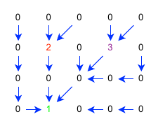

Catchment delineation
=====================

A common task in hydrology is identifying the catchment area for a given point in a river network.
Catchment delineation determines the area that drains into a specific outlet point.

In earthkit-hydro, you specify start locations and label all nodes flowing towards those locations with labels from 0, ... ,number of locations - 1.
If start locations belong to the same catchment, the node furthest downstream takes priority and overwrites any upstream start locations.

.. raw:: html

    

.. code-block:: python

    import earthkit.hydro as ekh

    network = ekh.river_network.load("efas", "5")
    labelled_field = ekh.catchments.find(network, locations)

Subcatchments
-------------

Subcatchments can be found by setting ``overwrite=False``, which preserves all subcatchment boundaries rather than letting downstream outlets overwrite upstream ones.

.. code-block:: python

    labelled_field = ekh.catchments.find(
        network,
        locations,
        overwrite=False
    )

.. raw:: html

    

Catchment outlines
------------------

``ekh.catchments.find`` gives the catchments as a labelled field. To get their
boundaries as geometry instead, use ``ekh.catchments.outline``, which traces each
catchment along the edges of its gridcells and returns the corners as
``(latitude, longitude)`` pairs.

.. code-block:: python

    outlines = ekh.catchments.outline(network, locations)

    for outline in outlines:
        plt.plot(outline[:, 1], outline[:, 0])

Passing a dict of named locations returns a dict of outlines keyed the same way,
mirroring :doc:`specify_locations`.

.. code-block:: python

    locations = {"Cologne": (50.94, 6.96), "Basel": (47.56, 7.59)}
    outlines = ekh.catchments.outline(network, locations)

    plt.plot(outlines["Basel"][:, 1], outlines["Basel"][:, 0])

A catchment whose boundary has more than one ring (because it encloses a hole, or
because parts of it touch only diagonally) comes back as a single array with a row
of NaNs between consecutive rings, largest ring first. Plotting libraries break the
line at the NaNs, so the rings are drawn separately.

See also
--------

- :doc:`../tutorials/finding_catchments` — Tutorial walkthrough
- :doc:`../tutorials/catchment_outlines` — Tutorial comparing the labelled field with the outline
- :doc:`../concepts/catchment_concepts` — Catchment concepts explained
- :doc:`specify_locations` — How to specify outlet locations
- :doc:`compute_catchment_statistics` — Compute statistics over catchments
- :doc:`../autodocs/earthkit.hydro.catchments` — API reference
